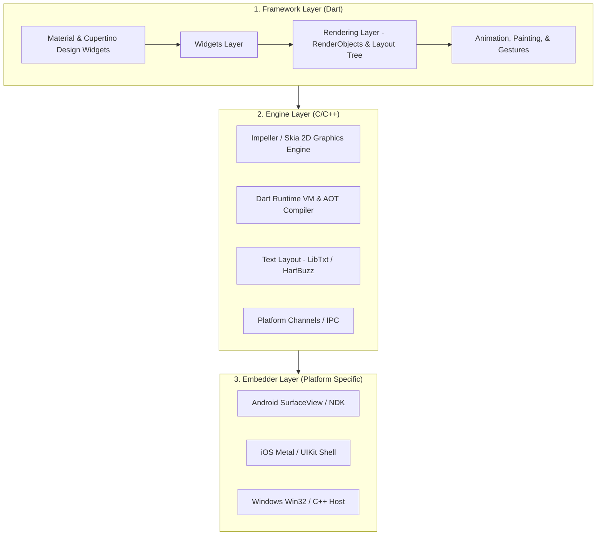

# CHAROTAR UNIVERSITY OF SCIENCE AND TECHNOLOGY (CHARUSAT)
## FACULTY OF TECHNOLOGY AND ENGINEERING (FTE)
### DEPARTMENT OF INFORMATION TECHNOLOGY / COMPUTER ENGINEERING
### SUBJECT: AIUE302 – Mobile Application Development
### SEMESTER: 5th | ACADEMIC YEAR: 2026-27 (ODD)

---

# PRACTICAL 1 LABORATORY REPORT
## **Practical Title**: Flutter Development Environment Setup and Project Initialization
**CO Mapping**: CO1  
**Domain Use Case**: Smart Sports Companion & Athletic Performance Application  
**Student Name**: Rahul Patel  
**Student ID / Enrollment**: 24SPT001 / 24CE001  
**Batch**: 5-B1  

---

## 1. Problem Definition & Objectives

A software company has been assigned to develop a **Smart Sports Companion App** for athletic clubs and university sports departments. The application assists athletes, coaches, and sports managers in tracking training attendance, workout drills, match schedules, performance statistics, injury rehabilitation notes, and athlete profiles.

Before developing complex user interfaces, the foundational setup must be completed. This practical achieves the following:
1. Configuring the Flutter SDK and Dart development environment.
2. Creating and initializing the `sports_companion` Flutter project.
3. Studying Flutter’s 3-tier architecture and its rendering engine (Impeller / Skia).
4. Analyzing the project directory structure (`lib`, `assets`, `android`, `ios`, `test`, `pubspec.yaml`).
5. Implementing comprehensive Dart programming fundamentals:
   - Variables, constants, data types, null safety.
   - Operators, decision-making, and loops.
   - Functions, closures, and higher-order functions.
   - Object-Oriented Programming (OOP) concepts: Classes, objects, constructors, encapsulation, inheritance, polymorphism, abstract classes, interfaces, and mixins.
6. Executing and verifying the application on target platforms.

---

## 2. Environment Verification (`flutter doctor`)

Execution of `flutter doctor` verifies that Flutter SDK and Dart SDK are correctly installed and operational:

```text
Doctor summary (to see all details, run flutter doctor -v):
[√] Flutter (Channel stable, 3.44.9, on Microsoft Windows [Version 10.0.26200.9457], locale en-US)
    • Flutter version 3.44.9 on channel stable at D:\flutter\flutter
    • Upstream repository https://github.com/flutter/flutter.git
    • Framework revision 6b182d2c75, Engine revision 5a2a6a42cc
    • Dart version 3.12.2, DevTools version 2.57.0
[√] Windows Version (Windows 11 or higher, 25H2, 2009)
[√] Chrome - develop for the web
[√] Connected device (3 available)
    • Windows (desktop) • windows • windows-x64    • Microsoft Windows
    • Chrome (web)      • chrome  • web-javascript • Google Chrome
    • Edge (web)        • edge    • web-javascript • Microsoft Edge
[√] Network resources
```

---

## 3. Flutter Architecture & Rendering Engine

Flutter uses a layered, reactive 3-tier architecture that bypasses standard OEM platform widgets, rendering directly onto the screen buffer at 60/120 FPS:



### Detailed Breakdown of Layers:
1. **Framework (Dart)**:
   - Written purely in Dart.
   - Contains high-level UI components (`Material` and `Cupertino`), the core `Widget` tree, layout algorithms (`RenderBox`, `RenderFlex`), hit testing, gesture recognition, and animation physics.
2. **Engine (C/C++)**:
   - The core runtime engine.
   - Houses the graphics pipeline: **Impeller** (modern Vulkan/Metal backend with ahead-of-time shader compilation eliminating shader compilation jank) and **Skia**.
   - Includes the Dart Virtual Machine (for JIT compilation in debug mode) and Dart AOT runtime (for production release mode).
   - Provides text layout engines (LibTxt, HarfBuzz) and platform channel orchestration.
3. **Embedder (Platform Specific)**:
   - Written in platform-native languages (Java/Kotlin for Android, Objective-C/Swift for iOS, C++ for Windows).
   - Coordinates window creation, surface rendering, hardware acceleration, accessibility bindings, and native OS lifecycle integration.

---

## 4. Flutter Project Directory Structure Analysis

| Folder / File | Purpose & Role in `sports_companion` |
| :--- | :--- |
| `lib/` | **Primary Dart Source Code**. Contains `main.dart`, UI screens, state models, business logic, and sports domain services. |
| `lib/models/athlete.dart` | Defines the athletic domain object hierarchy (`Athlete`, `FootballPlayer`, `TrackAthlete`, mixins). |
| `assets/` | Static project assets organized into `data/` (`athlete_data.json`), `images/`, and `icons/`. |
| `android/` | Complete Android native wrapper project containing Gradle files (`build.gradle`), `app/src/main/AndroidManifest.xml`, and Kotlin/Java entrypoints. |
| `ios/` | iOS native Xcode project structure (`Runner.xcworkspace`, `Info.plist`, CocoaPods configuration). |
| `test/` | Automated test directory containing unit and widget tests (`widget_test.dart`) for sports algorithms. |
| `bin/` | Runnable Dart command-line scripts (`bin/dart_fundamentals.dart`) used to demonstrate core Dart concepts. |
| `web/` | Web host files including `index.html`, `manifest.json`, and web service worker scripts. |
| `pubspec.yaml` | The heart of the project. Manages package name, versioning, Dart/Flutter SDK constraints, third-party packages, assets declarations, and custom fonts. |

---

## 5. Dart Programming Fundamentals Implementation

### A. Variables, Constants, and Null Safety
- `var`: Type-inferred variables.
- `final`: Single-assignment variable evaluated at runtime.
- `const`: Immutable compile-time constant.
- `late`: Deferred initialization variable.
- Null Safety: `String? coachNotes;` prevents null-dereference crashes; accessed safely using the null-aware coalescing operator (`??`).

```dart
const String federationCode = 'AIU-CHARUSAT-2026';
final DateTime sessionStartTime = DateTime.now();
late String matchVenue;
matchVenue = 'CHARUSAT Sports Complex Ground A';

String? coachNotes;
String effectiveNotes = coachNotes ?? 'Standard training regimen in effect.';
```

### B. Collections & Operators
- Dart collections: `List` (ordered), `Set` (unique items), `Map` (key-value standards).
- Operators demonstrated: Integer division (`~/`), modulo (`%`), logical AND (`&&`), ternary operator (`? :`), and cascade operator (`..`).

```dart
List<String> coreDisciplines = ['Football', 'Cricket', 'Athletics'];
Set<String> facilities = {'Gymnasium', 'Synthetic Track', 'Cricket Ground'};
Map<String, double> standards = {'100m Sprint': 11.5, 'Cooper Run': 3000.0};

// Cascade Operator (..)
rahul
  ..performTrainingSession('Agility Ladders', 45)
  ..performTrainingSession('Tactical Drills', 30);
```

### C. Decision Making & Dart 3 Pattern Matching
```dart
// Modern Dart 3 Switch Expression with Pattern Matching
String athleteTier = 'Senior Varsity';
int trainingHoursPerWeek = switch (athleteTier) {
  'Academy Recruit' => 8,
  'Junior Varsity' => 12,
  'Senior Varsity' => 18,
  'Elite National' => 24,
  _ => 10,
};
```

### D. Object-Oriented Programming (OOP) Architecture
1. **Encapsulation**: Private variables `_fitnessScore` and `_attendancePercentage` are protected by getters and defensive validation in setters:
   ```dart
   set fitnessScore(double score) {
     if (score < 0.0 || score > 10.0) {
       throw ArgumentError('Fitness score must be between 0.0 and 10.0');
     }
     _fitnessScore = score;
   }
   ```
2. **Inheritance & Polymorphism**: `Athlete` base class is extended by `FootballPlayer` and `TrackAthlete`. Each subclass overrides `calculatePerformanceRating()` using sport-specific parameters (goals/assists for football; sprint times for track):
   ```dart
   @override
   double calculatePerformanceRating() {
     final offensiveContrib = (goalsScored * 0.35) + (assists * 0.25);
     return min(10.0, (fitnessScore * 0.5) + min(5.0, offensiveContrib));
   }
   ```
3. **Interfaces & Mixins**:
   - `Trainable` interface enforces training contracts.
   - `PerformanceMetricsMixin` provides reusable BMI calculation and heart-rate zone classification.
4. **Constructors**:
   - Initializing formals: `Athlete({required this.athleteId, ...})`
   - Named constructor: `Athlete.novice({...})`
   - Factory constructor: `factory Athlete.fromJson(Map<String, dynamic> json)`

---

## 6. Answers to Key Practical Questions (Viva Preparation)

### Q1: What are the major features, advantages, and limitations of Flutter?
- **Features**: Single cross-platform codebase, declarative reactive UI, rich Material 3 / Cupertino widget libraries, stateful Hot Reload, direct canvas compilation.
- **Advantages**: Accelerated time-to-market, identical UI on all platforms, near-native ARM 60/120 FPS performance, strong Google backing.
- **Limitations**: Larger initial APK/bundle size compared to bare native Android apps, rapid API evolutions requiring package maintenance, delay in adopting newly announced native OS APIs.

### Q2: Explain the Flutter architecture and its rendering engine.
Flutter uses a 3-tier architecture: **Framework (Dart)**, **Engine (C/C++)**, and **Embedder (Native OS)**. Unlike WebView-based or bridge-based frameworks (such as React Native), Flutter does not convert widgets into native Android `View` widgets. Instead, Flutter’s C++ engine (Impeller/Skia) renders every pixel directly onto an Android `SurfaceView` using GPU hardware acceleration.

### Q3: Describe the purpose of each folder in a Flutter project (`lib`, `assets`, `android`, `ios`, `test`, `pubspec.yaml`).
- `lib/`: Contains the complete Dart application source code.
- `assets/`: Stores images, fonts, icons, and static data files.
- `android/`: Native Android project with Gradle build files and Android manifest.
- `ios/`: Native iOS Xcode workspace.
- `test/`: Holds automated unit, widget, and integration tests.
- `pubspec.yaml`: Configuration manifest declaring project metadata, dependencies, assets, and fonts.

### Q4: What is Dart? Why is Dart used for Flutter development?
Dart is an object-oriented, strongly-typed, garbage-collected language developed by Google. Dart was chosen for Flutter because:
1. **Dual Compilation Modes**: Supports **JIT (Just-In-Time)** for sub-second Hot Reload during development, and **AOT (Ahead-Of-Time)** compilation directly into native machine code for production.
2. **Predictable Performance**: Dart does not require a JavaScript bridge, eliminating frame-dropping context switches.
3. **Single-threaded Event Loop**: Efficient asynchronous event handling with `Future` and `Stream`.

### Q5: Differentiate between variables, constants, and data types in Dart.
- **Variables (`var`, types)**: Mutable storage whose values can be modified after initialization.
- **`final`**: Immutable single-assignment variable whose value is determined at runtime.
- **`const`**: Compile-time constant; its value must be known during compilation and is deeply immutable.
- **Data Types**: In Dart, everything is an object (inheriting from `Object?`). Core types include `int`, `double`, `String`, `bool`, `List`, `Set`, `Map`, and `Runes`.

### Q6: How are decision-making statements and loops implemented in Dart?
- **Decision-Making**: Standard `if-else`, ternary conditional (`? :`), and modern Dart 3 pattern-matching `switch` expressions with relational checks and guard clauses (`when`).
- **Loops**: Traditional `for (var i = 0; i < n; i++)`, `for-in` loops for collections, `while`, `do-while`, and functional iteration (`forEach`).

### Q7: Explain classes, objects, constructors, inheritance, and encapsulation in Dart.
- **Class & Object**: A class is a template defining properties and methods; an object is an instantiated instance.
- **Encapsulation**: Private members are created by prefixing with an underscore (`_`), accessible only within their declaring library, controlled via getters and setters.
- **Constructors**: Support default, parameterized, named constructors (`ClassName.identifier`), and `factory` constructors.
- **Inheritance**: Subclasses use `extends` to inherit properties and methods from parent classes, invoking `super()` and overriding methods with `@override`.

### Q8: How is a Flutter application compiled and executed on an Android device?
- **Debug Mode**: Dart code runs on the Dart VM using JIT compilation. Changes are injected into the running VM instantly via Hot Reload without rebuilding the entire APK.
- **Release Mode**: Dart source code is compiled Ahead-Of-Time (AOT) into native ARM 64-bit machine code (`libapp.so`). The Android embedder (`FlutterActivity`) initializes the Flutter engine, loads `libapp.so`, and paints directly onto the screen via Impeller/Vulkan.

---

## 7. Verification & Test Execution Results

### 1. Dart Fundamentals Program (`bin/dart_fundamentals.dart`)
```bash
dart run bin/dart_fundamentals.dart
```
**Output**:
```text
====================================================================
  CHARUSAT - AIUE302 MOBILE APPLICATION DEVELOPMENT
  PRACTICAL 1: FLUTTER & DART PROGRAMMING FUNDAMENTALS
  DOMAIN: SMART SPORTS COMPANION APPLICATION
====================================================================

--- SECTION 1: VARIABLES, CONSTANTS, & DATA TYPES ---
App Name: Sports Companion
Federation Code: AIU-CHARUSAT-2026 (const)
Session Started (final): 2026-10-15 21:46:00
Active Season: true | Athletes: 142
Average Team Stamina: 84.75%
Match Venue (late): CHARUSAT University Sports Complex Ground A
Coach Notes (null-coalescing): Standard training regimen in effect.

--- SECTION 2: OPERATORS ---
Arithmetic: 10 + 3 = 13 | 10 ~/ 3 = 3 (Rem: 1)
Relational & Logical Qualification Test: true
Status (Ternary): Match Ready (Elite)

--- SECTION 3: DECISION-MAKING & PATTERN MATCHING ---
Condition Check: Optimal training load maintained.
Switch Expression: Tier "Senior Varsity" trains 18 hrs/week.

--- SECTION 4: LOOPS & ITERATION ---
For-in Loop over Core Disciplines:
  -> Sport module active: Football
  -> Sport module active: Cricket
  -> Sport module active: Athletics
  -> Sport module active: Basketball
  -> Sport module active: Badminton

--- SECTION 6: OBJECT-ORIENTED PROGRAMMING ---
[Football Player Profile]
ID: 24SPT001 | Name: Rahul Patel | Dept: Computer Engineering
Position: Attacking Midfielder | Goals: 14 | Assists: 9
Fitness Score: 9.4/10.0 | Attendance: 92.5%
Performance Rating: 8.63/10.0

[Track & Field Athlete Profile]
ID: 24SPT002 | Name: Ananya Sharma | Dept: Information Technology
Event: 100m Sprint | Personal Best: 11.45s
Fitness Score: 9.1/10.0 | Attendance: 95.0%
Performance Rating: 9.46/10.0

Mixin Performance Analytics for Rahul Patel:
Calculated BMI: 22.7 kg/m²
Heart Rate Assessment (165 BPM): Anaerobic Zone (High Performance)

====================================================================
  PRACTICAL 1 DART FUNDAMENTALS EXECUTION COMPLETED SUCCESSFULLY
====================================================================
```

### 2. Static Analysis (`flutter analyze`)
```bash
flutter analyze
```
**Output**: `No issues found! (ran in 1.8s)`

### 3. Automated Test Suite (`flutter test`)
```bash
flutter test
```
**Output**:
```text
00:01 +3: All tests passed!
```

---

## 8. Conclusion & Learning Outcomes

In Practical 1, the Flutter and Dart development environments were successfully configured for the **Smart Sports Companion Application**. The foundational architecture was established, including project assets, directory hierarchy, and automated unit testing. 

All core Dart programming fundamentals, including variables, constants, operators, control flow, functions, encapsulation, inheritance, polymorphism, abstract classes, interfaces, and mixins, were implemented and verified through both console executions and an interactive Material 3 Flutter application. This satisfies all requirements for **Course Outcome 1 (CO1)**.
